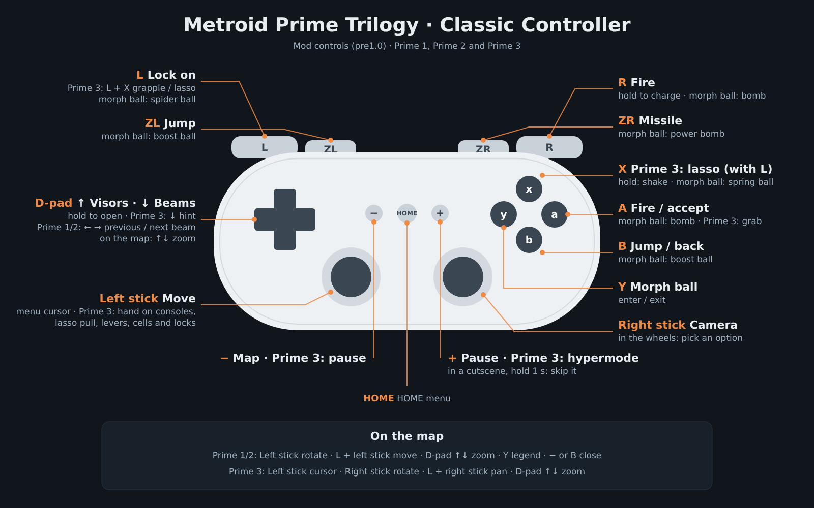

# Metroid Prime Trilogy — Classic Controller mod

A Gecko code to play **Metroid Prime Trilogy** (Wii, PAL **R3MP01**) with the **Classic Controller** (or Classic Controller Pro), using twin-stick controls in the style of *Metroid Prime Remastered*. It covers **Metroid Prime**, **Metroid Prime 2: Echoes**, **Metroid Prime 3: Corruption** and the Trilogy menu, all in **one code**. No pointing at the screen and no motion gestures.

> **Status: pre1.0.** Tested on **Dolphin**. Testing on a real Wii (USB Loader GX) is in progress.

## Features
- **Twin-stick aiming in all three games:** left stick moves, right stick turns the camera with a centred reticle (based on PrimeHack).
- **Visor and beam wheels:** hold the D-pad and pick with the right stick. In Prime 1 and 2, D-pad left/right also cycles beams, skipping the ones you don't have.
- **No gestures in Prime 3:** grapple lasso with L + X, shake by holding X, levers, cells and locks with the left stick, and the hand on consoles with the left stick.
- **Comfortable menus:** left-stick cursor, A to accept and B to go back, map with zoom on the D-pad.
- **Skip cutscenes:** hold + for one second, in all three games.
- **Normal Wii HOME menu:** the mod stays out of the way while it is open.

## Controls
**Playing** (all three games)
| Classic Controller | Action |
|---|---|
| Left stick | Move · in Prime 3, the hand on consoles |
| Right stick | Camera, reticle always centred · in the wheels: pick an option |
| A / R | Fire (hold to charge) |
| ZR | Missile |
| L | Lock on |
| B / ZL | Jump |
| Y | Morph ball |
| D-pad up (hold) | Visor wheel |
| D-pad down (hold) | Prime 1 and 2: beam wheel · Prime 3: hint |
| D-pad left / right | Prime 1 and 2: previous / next beam · Prime 3: nothing |
| − | Prime 1 and 2: map · Prime 3: pause |
| + | Prime 1 and 2: pause · Prime 3: hypermode · in a cutscene, hold 1 s to skip it |
| HOME | HOME menu |

**Prime 3 motion controls**
| Classic Controller | Action |
|---|---|
| L + X (with a grapple point or lasso target locked) | Throw the grapple / lasso |
| Left stick down (lasso attached) | Pull (Samus doesn't walk backwards); keep pulling to rip it off |
| X (hold) | Shake off enemies that latch onto you |
| Left stick sideways | Combination locks and DNA scanners |
| A + left stick | Levers, handles and cells: grab with A; push in = forward, pull out = back, turn = sideways |

**Morph ball:** A / R bomb · X spring ball (one jump per press) · B / ZL boost · L spider ball · ZR power bomb · Y leave the morph ball.

**Menus** (pause, inventory, Trilogy menu, HOME menu): left stick = cursor, A = accept, B = back, D-pad = D-pad.
On the **Prime 1 / Prime 2 map**: D-pad up/down = zoom, left stick = rotate, L + left stick = move, Y = legend. On the **Prime 3 map**: left stick = cursor, right stick = rotate, L + right stick = move, D-pad up/down = zoom. In the **Prime 1 pause**, D-pad left = Options and right = Logbook.

## Installation
You need the **European PAL release of Metroid Prime Trilogy (R3MP01)**. Other releases are not supported.

**Dolphin**
1. Enable cheats: *Config → General → Enable Cheats*.
2. Copy [`codes/R3MP01.ini`](codes/R3MP01.ini) to `Documents/Dolphin Emulator/GameSettings/` (back up any existing `R3MP01.ini` first).
3. Set Wii Remote 1 to *Emulated Wii Remote* and choose **Classic Controller** as the extension.
4. In the game's *Properties → Gecko Codes*, tick **only** "Classic Controller pre1.0".

**Wii (USB Loader GX)**
1. Copy [`codes/R3MP01.gct`](codes/R3MP01.gct) to `SD:/codes/`.
2. In the game's settings: **Ocarina: On**, **Hook Type: VBI**, **Debugger: Off** (with the debugger on, the code doesn't fit), **Alternate DOL: Off** (boot Trilogy normally and pick the game from its menu).
3. Plug the Classic Controller into the Wii Remote before starting the game.
4. If the loader says it cannot find the cheat file, copy [`codes/R3MP01.txt`](codes/R3MP01.txt) to `SD:/txtcodes/` and create the GCT from the loader's cheat manager.

More detail in [docs/GUIDE.md](docs/GUIDE.md).

## Files
| Path | Contents |
|---|---|
| `codes/R3MP01.ini` | The code, enabled, for Dolphin |
| `codes/R3MP01.gct` | The code, for the Wii (USB Loader GX) |
| `codes/R3MP01.txt` | The code in the cheat-manager text format |
| `codes/classic_controller.txt` | The code on its own, to paste by hand |
| `docs/` | English guide, Spanish guide (`GUIA.md`), controls image and the uncompressed code list |
| `src/` | Generator for the code (PowerPC assembly → compressed Gecko code) |

To rebuild the code: `pip install keystone-engine`, then `python src/base.py out`. It writes the files to `out/` and gives the same `R3MP01.gct` byte for byte. (Comments in the source are in Spanish.)

## How it fits
Dolphin allows at most 3272 bytes of Gecko codes. The full mod is 4144 bytes, so the code is stored **compressed** (2984 bytes) and unpacks itself into free memory when the game starts. The controls logic is written once and shared by the three games; each game only adds its own addresses. Because of this, don't enable other large codes at the same time.

## Notes
- The in-game button icons still show the Wii Remote and Nunchuk.
- Don't touch the sticks while the game boots: the Wii takes that position as the centre.

## Credits
- Made by **AdrianGR517**, with the help of **Claude** (Anthropic's AI assistant), which wrote and debugged most of the PowerPC code and documentation together with him.
- Camera and motion-control patches are based on [PrimeHack](https://github.com/shiiion/dolphin).
- Sister project: [Metroid Prime 3 Classic Controller mod](../metroid-prime-3/).

## License
[MIT](LICENSE)
